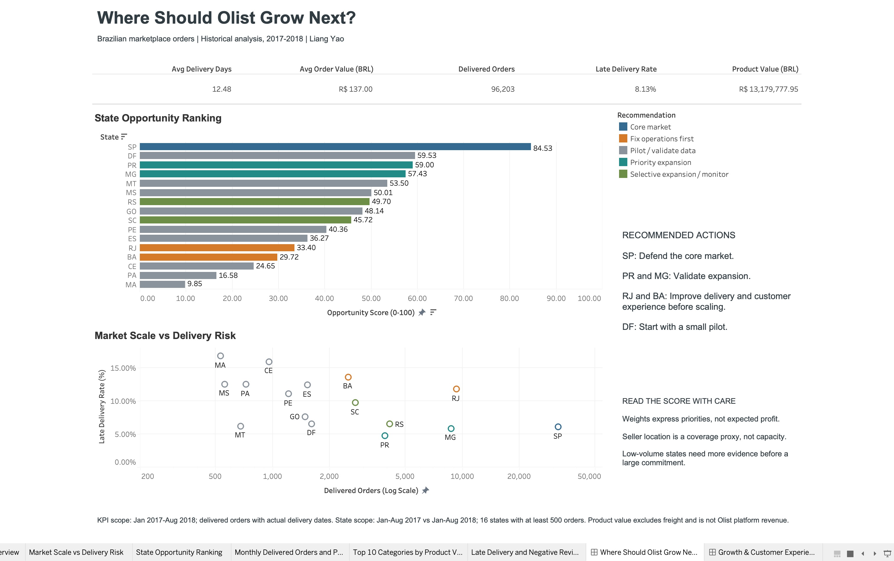
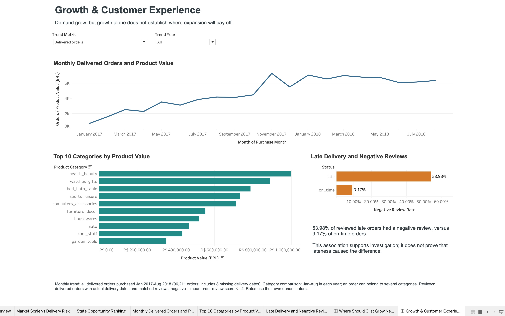

# Where Should Olist Grow Next?

**A marketplace growth and operations case study by Liang Yao**  
SQL (DuckDB) · Python · Tableau

A large market is not always the next market to expand. This project uses Olist's historical orders to compare demand, growth, delivery reliability, and customer experience across Brazilian states. The result is a shortlist for further validation, not a forecast of returns.

## Recommendation

Keep **SP** as the core market, investigate expansion in **PR and MG**, and address delivery and customer-experience problems in **RJ and BA** before scaling further. **DF** scores well but has a smaller sample, so a limited pilot is more defensible than a broad rollout.

| Market | Delivered orders | Late-delivery rate | Negative-review rate | Suggested action |
| --- | ---: | ---: | ---: | --- |
| SP | 31,907 | 6.03% | 10.59% | Defend the core market |
| PR | 3,904 | 4.74% | 10.37% | Validate expansion |
| MG | 8,693 | 5.84% | 11.97% | Validate expansion |
| RJ | 9,307 | 11.78% | 17.53% | Fix operations first |
| BA | 2,497 | 13.62% | 17.12% | Fix operations first |
| DF | 1,602 | 6.55% | 12.61% | Run a small pilot |

These state metrics compare **January-August 2017 with January-August 2018**, keeping the seasonal windows consistent. The scoring universe contains 16 states with at least 500 delivered orders across the two windows and recorded actual delivery dates. Negative-review rates use reviewed orders, not all delivered orders.

## Evidence Behind the Recommendation

- Across the broader January 2017-August 2018 window, 96,203 delivered orders with recorded delivery dates generated **R$13.18 million in product value**. **8.13%** arrived after their estimated delivery timestamp.
- Negative reviews occurred on **53.98% of reviewed late orders**, compared with **9.17% of reviewed on-time orders**. This is an association, not evidence that lateness alone caused the difference.
- SP, DF, PR, and MG remained the top four under the baseline, growth-first, and reliability-first weighting scenarios, although DF and PR switched positions. This checks sensitivity to three chosen weight sets; it does not validate the model against future outcomes.

Product value is the sum of item prices, excluding freight. It is **not Olist's platform revenue, profit, or commission income**. No business impact or realized improvement is claimed.

## Explore the Work

| File | Purpose |
| --- | --- |
| [Tableau packaged workbook](dashboard/olist_growth_dashboard.twbx) | Two dashboard pages with embedded aggregate data; open this file, not the source template |
| [Two-page PDF preview](dashboard/olist_growth_dashboard_preview.pdf) | Static screenshots of the actual Tableau presentation |
| [Analysis notebook](notebooks/01_state_opportunity_analysis.ipynb) | Data checks, state scoring, sensitivity tests, and recommendations |
| [SQL queries](sql/) | Twenty numbered queries, from initial exploration to comparable-period score inputs |
| [Metric definitions](docs/methodology.md) | Cohorts, formulas, score weights, and limitations |
| [Project walkthrough](docs/project_walkthrough.md) | How the data, SQL, notebook, and dashboard fit together |
| [Validation record](docs/validation.md) | Data, workbook, and desktop checks, with dates |

Both pages were opened and visually checked in Tableau Public on October 8, 2026. The monthly year and metric controls were tested. Selecting SP highlighted it in both state charts, clearing the selection restored the other states, and the overall KPIs stayed unchanged. Rendered tooltips on both pages were checked on October 22, 2026, including the state, category, and on-time review tooltips.

### Dashboard Preview





These are screenshots from the actual workbook, not charts recreated in another tool. The PDF wraps the same two screenshots. Native image/PDF export was unavailable in the tested local Public edition; the `.twbx` remains the interactive deliverable.

## Reproduce the Analysis

Download the [Brazilian E-Commerce Public Dataset by Olist](https://www.kaggle.com/datasets/olistbr/brazilian-ecommerce) and extract its nine CSV files into `data/raw/`. Keep the original filenames. Raw data and the local DuckDB file are excluded from Git.

Run the following from the project root. Close other connections to `data/olist.duckdb` before rebuilding it.

```bash
python3 -m venv .venv
source .venv/bin/activate
python -m pip install -r requirements-tableau.txt
python -m ipykernel install --prefix "$VIRTUAL_ENV" --name python3
python scripts/build_database.py
jupyter nbconvert --to notebook --execute --inplace notebooks/01_state_opportunity_analysis.ipynb
python scripts/export_tableau_data.py
python scripts/verify_project.py
python scripts/build_tableau_workbook.py
python scripts/verify_tableau_workbook.py
```

The notebook updates its saved outputs in place. `verify_project.py` instead rebuilds and executes the analysis in a temporary directory, then compares the results with the saved CSVs. `build_tableau_workbook.py` embeds five small CSV/Hyper data sources in the `.twbx` file; opening that package does not require the original CSV paths. After changing the workbook, refresh its screenshots in Tableau before running `python scripts/build_dashboard_preview.py`; rebuilding data alone does not refresh static previews.

For a single SQL query:

```bash
python scripts/run_sql.py sql/20_state_score_inputs.sql
```

## Project Layout

```text
data/raw/          Original CSVs, downloaded separately
sql/               Numbered analysis queries
notebooks/         Scoring and exploratory analysis
scripts/           Database build, exports, verification, workbook build
outputs/tableau/   Five aggregate Tableau inputs
dashboard/         Packaged workbook and build template
docs/              Methodology, walkthrough, validation, release checklist
```

The earlier learning notes in `docs/analysis_notes.md` are retained as a working history. The English methodology document defines the final dashboard's metric scopes.

## Limits and Next Decision

This is a historical sample, not a current market assessment. The dataset does not contain acquisition costs, contribution margins, reliable seller capacity, or a record of an expansion intervention. Seller location is only a coverage proxy; customers can buy from sellers in other states. Min-max scores depend on the included states, and the chosen weights and thresholds reflect judgment.

Before funding expansion, validate the shortlist against more recent demand, unit economics, shipping costs, and seller availability. For PR or MG, define a small pilot with contribution margin, repeat purchase, late delivery, and negative reviews as decision criteria. Do not turn the historical growth percentages into a promised uplift.

## My Role and AI Assistance

I designed and carried out this project while building my SQL, Python, and Tableau skills. I framed the business question, wrote and ran the SQL, worked through the join and metric-definition problems, interpreted the results, and built the first version of the dashboard. The analytical choices and the final recommendation are mine.

I used Codex as an assistant for explanations and debugging, and for help with export conventions, reproducibility checks, the scripted workbook build, and documentation drafts. This is a learning and portfolio project using public historical data, not client work or a deployed business intervention.

## Data Attribution

Source: Olist, [Brazilian E-Commerce Public Dataset](https://www.kaggle.com/datasets/olistbr/brazilian-ecommerce), listed under [CC BY-NC-SA 4.0](https://creativecommons.org/licenses/by-nc-sa/4.0/). The included summaries and embedded Tableau extracts are derived from that dataset; retain attribution and its applicable terms when sharing them. Raw records are not bundled in this repository.
